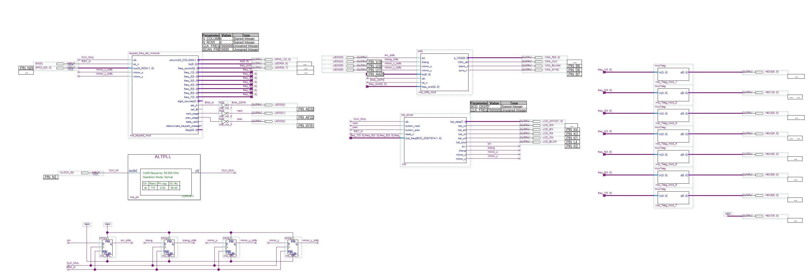
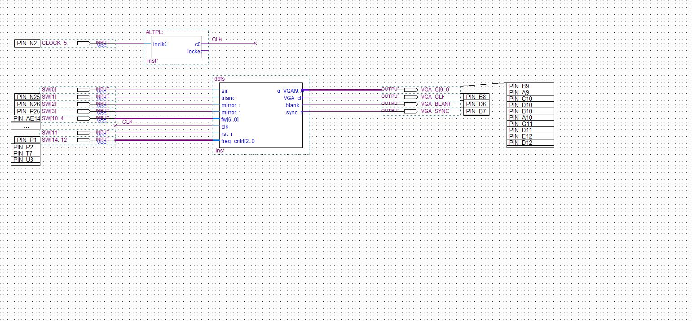
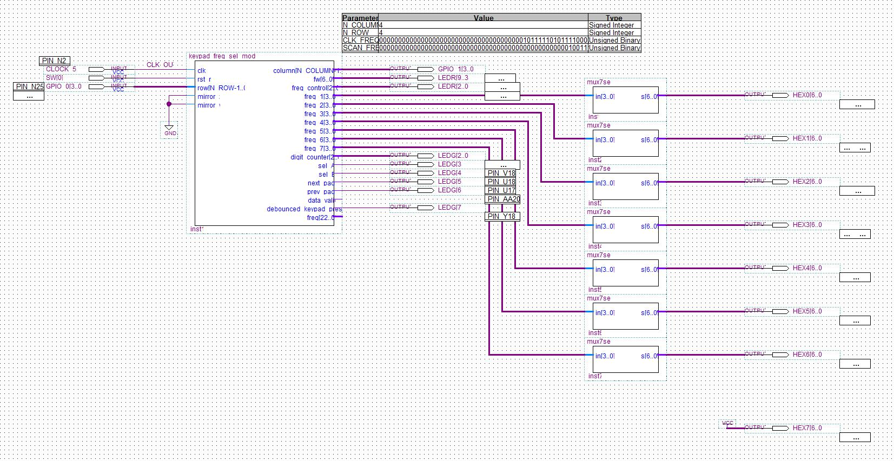
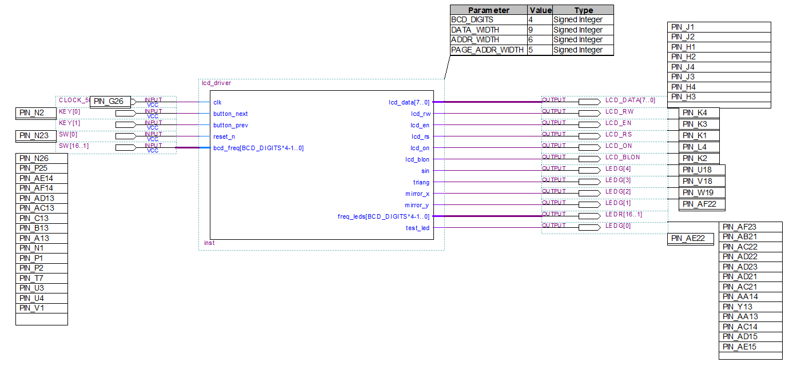
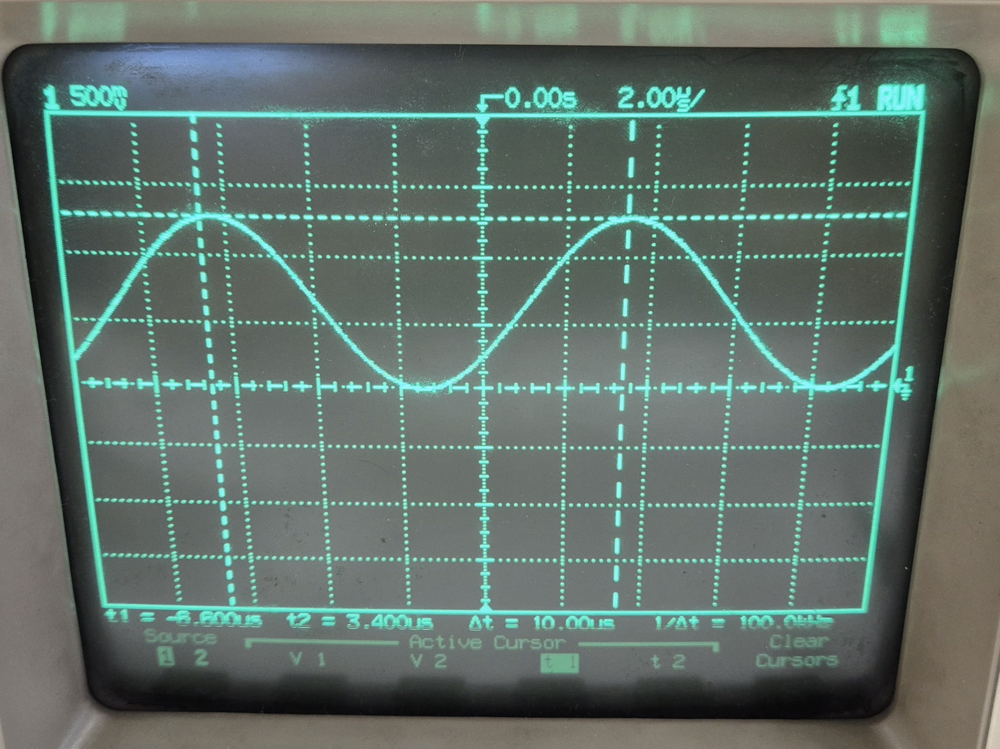
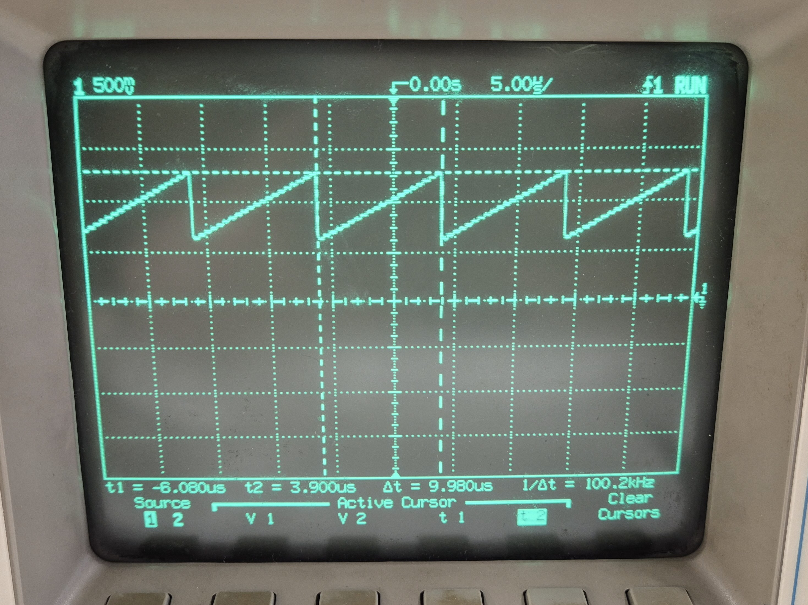

<p align="left">
  <a href="https://www.intel.com/content/www/us/en/software/programmable/quartus-prime/overview.html"></a>
  <a href="https://www.verilog.com/"></a>
  <a href="#"></a>
  <a href="./Relazione/Relazione%20Costruzioni.pdf"></a>
</p>

# Unipi Frequency Generator

A digital function generator based on **Direct Digital Frequency Synthesis (DDFS)**, implemented on an **Altera Cyclone II FPGA (EP2C35F672C6)** mounted on the **Altera DE2 development board**.

The system generates sinusoidal, triangular, sawtooth, and square waveforms, with an adjustable output frequency ranging from **1 Hz to 1 MHz**. The frequency is configured through a 4×4 matrix keypad and displayed in real time on a 16×2 LCD.

This project was developed for the *Microelectronic System Design* course (Academic Year 2025/2026) at the Department of Information Engineering, University of Pisa.

# Key Features

- **DDFS Digital Synthesis:** Waveform generation using a phase accumulator and an optimized quarter-wave Look-Up Table (LUT) containing 1024 samples × 12 bits.
- **Supported Waveforms:**
  - Sinusoidal waveforms: full-wave, rectified, and quarter-wave configurations.
  - Triangular and sawtooth waveforms.
  - Square waveforms.
- **Symmetry and Mirroring:** Vertical (`mirror_y`) and horizontal (`mirror_x`) waveform symmetry control.
- **Human-Machine Interface (HMI):**
  - 4×4 matrix keypad for direct frequency input in BCD format and menu navigation.
  - 16×2 LCD (CFAH1602B-TMC-JP) displaying the selected waveform and current frequency in Hz.
- **Digital-to-Analog Conversion (DAC):** Output routed to the 10-bit VGA DAC (ADV7123) integrated into the DE2 board. The design is also compatible with an external 12-bit R-2R DAC.
- **Clock Management and Programmable Frequency Divider:**
  - **70 MHz** system clock generated by an internal PLL from the board's 50 MHz clock.
  - Dynamic frequency divider with a division factor ranging from 2 to 1,000,000.

# System Architecture

The system is organized into three main functional blocks:

1. **Human-Machine Interface (HMI):** 4×4 matrix keypad and 16×2 LCD.
2. **Direct Digital Frequency Synthesizer (DDFS):** Phase accumulator, waveform mirroring logic, and waveform ROM.
3. **Digital-to-Analog Converter (DAC):** 10-bit ADV7123 VGA DAC integrated into the development board.



# Main Design Modules

### 1. DDFS Module (`ddfs.v`)

Generates the digital sample stream corresponding to the selected waveform.

- **LUT Optimization:** Stores only one quarter of the sinusoidal period (1024 × 12 bits) and reconstructs the complete waveform using horizontal and vertical symmetry.
- **Output Frequency Equation:**

  ```math
  f_{out} = \frac{f_{clk}}{N} \cdot \frac{f_w + 1}{\text{LUT\_DIM}}
  ```

  where `N ∈ [2, 1000000]` is the clock division factor and `LUT_DIM = 1024`.



### 2. Keypad and Frequency Selection Module (`keypad_freq_sel_module.v`)

 

- **Scanning:** Operates at a scanning frequency of 10 kHz to reduce errors caused by parasitic capacitances and key transitions.
- **Debouncing:** Implements a hardware debounce filter with an approximate delay of 100 ms.
- **Frequency Conversion:** Converts the user-entered BCD value into the frequency word `f_w` (7 bits) and the control code `freq_cntrl` (3 bits), using multiplication and bit-shifting operations to avoid dedicated hardware dividers.

### 3. LCD Driver Module (`lcd_driver.v`)

 

Based on two Finite State Machines (FSMs):

- **FSM 1:** Manages the first display row, showing the project title and selected waveform using `text_lut`.
- **FSM 2:** Continuously updates the frequency value, expressed in Hz, on the second display row.

---

## FPGA Resource Utilization

Results obtained using **Quartus II v13.0 SP1** for the **Cyclone II EP2C35F672C6 FPGA**.

| Hardware Resource | Used | Available | Utilization |
| :--- | ---: | ---: | ---: |
| **Logic Elements (LEs)** | 3,011 | 33,216 | 9% |
| **Dedicated Registers** | 700 | 33,216 | 2% |
| **Memory Bits (ROM/RAM)** | 29,696 | 483,840 | 6% |
| **9-bit Embedded Multipliers** | 70 | 70 | 100% |
| **PLLs** | 1 | 4 | 25% |
| **I/O Pins** | 109 | 475 | 23% |

### Maximum Operating Frequency (`F_max`)

- **System PLL clock (`CLOCK_PLL`, 70 MHz):** Maximum frequency of 79.10 MHz, with a positive slack of **+1.642 ns**.
- **Divided clock (`CLK_FREQ_DIV`, nominally 35 MHz):** Maximum frequency of 62.42 MHz, with a positive slack of **+3.873 ns**.

### Power Consumption

The estimated total thermal power is **229.34 mW**, according to the PowerPlay Power Analyzer.

# Hardware Testing and Verification

The circuit was tested on the **Altera DE2 development board**. The generated signals were inspected using an HP 100 MHz oscilloscope connected to the VGA output.

*Hardware test setup with the Altera DE2 board and a connected 4×4 matrix keypad.*

### Oscilloscope Waveforms

| Sinusoidal Wave (100 kHz) | Sawtooth Wave (100 kHz) |
| :---: | :---: |
|  |  |


## Repository Structure

```text
.
├── PSD_project.pdf                       # Complete technical report
├── PSD_project.zip                       # Archive containing project files and sources
├── PSD_project/                          # Folder containing complete report files
│   ├── chapters/
│   ├── img/
│   └── main.tex                       
└── main_function_generator/              # Main Quartus II project
    ├── main_function_generator.bdf       # Top-level block diagram
    ├── main_function_generator.qpf       # Quartus project file
    ├── main_function_generator.qsf       # Project settings and pin assignments
    └── modules/                          # HDL modules
        ├── DDFS module/                  
        │   ├── 12 bit DAC/               
        │   └── VGA DAC/                  
        │       ├── ddfs.v                
        │       ├── freq_divider_DDFS.v   
        │       ├── sin_lut.v             
        │       └── scilab_script/       
        ├── Keypad_frequency_select_module/ 
        │   ├── keypad_freq_sel_module.v  
        │   ├── keypad_module.v           
        │   ├── BCD_to_C1_converter.v     
        │   └── DDFS_frequency_converter.v 
        └── LCD module/                   
            ├── lcd_driver.v              
            └── text_lut.v                
